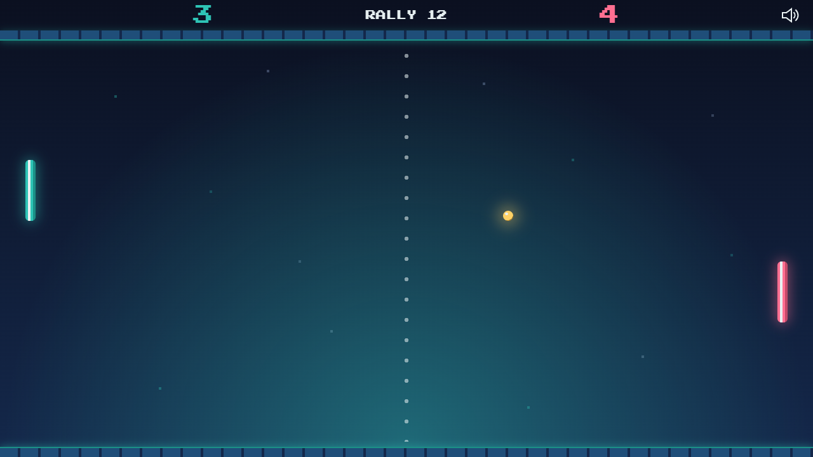
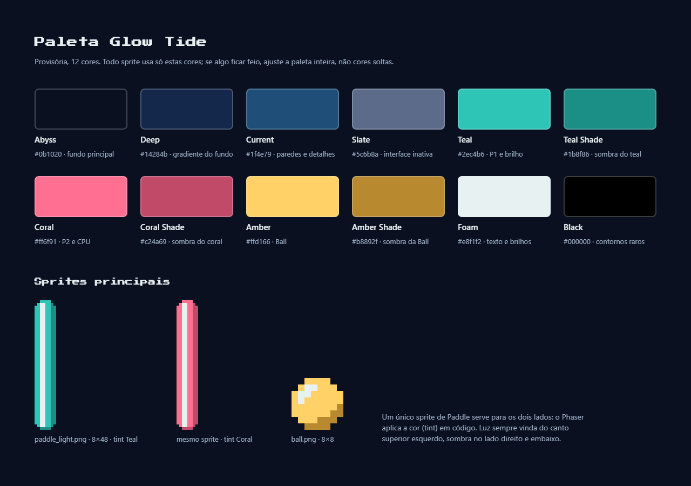

# Glow Tide Art Style

Rules that every sprite, background and UI element must follow.

## Mood

Calm deep ocean at night. Everything that matters emits light.

## Rules

1. **Simple:** basic shapes only (circle, capsule). Few pixels per object.
2. **Fast:** no black outlines. Shape comes from light and contrast against the background. One sprite = one shape, one highlight, one shadow.
3. **Useful:** every element must be readable in half a second. If a detail does not help the player, remove it.
4. **Synergistic:** one light source (top left), one palette, one shape language (rounded and glowing) for every asset.

## Technical rules

- Native resolution: 640x360. Draw at 1:1 and let Phaser scale the canvas. Never resize sprites inside Aseprite.
- Maximum 12 colors (palette below). To change a color, change the whole palette.
- Effects (glow, pulse, pop) are done in code with tweens, not with extra frames.
- Sprite files: English, lowercase, snake_case. Same name for the `.aseprite` source and the exported `.png`.

## Palette (provisional)

| Name        | Hex     | Use                      |
| ----------- | ------- | ------------------------ |
| Abyss       | #0b1020 | Main background          |
| Deep        | #14284b | Background gradient      |
| Current     | #1f4e79 | Walls and details        |
| Slate       | #5c6b8a | Inactive interface       |
| Teal        | #2ec4b6 | Player 1 and main glow   |
| Teal Shade  | #1b8f86 | Teal shadow              |
| Coral       | #ff6f91 | Player 2 and CPU         |
| Coral Shade | #c24a69 | Coral shadow             |
| Amber       | #ffd166 | Ball                     |
| Amber Shade | #b8892f | Ball shadow              |
| Foam        | #e8f1f2 | Text and highlights      |
| Black       | #000000 | Rare outlines (optional) |

## Checks before closing any sprite

- Does it follow the light direction (top left)?
- Does it use only palette colors?
- Is it still readable in grayscale?
- Can it be understood at its native size?

